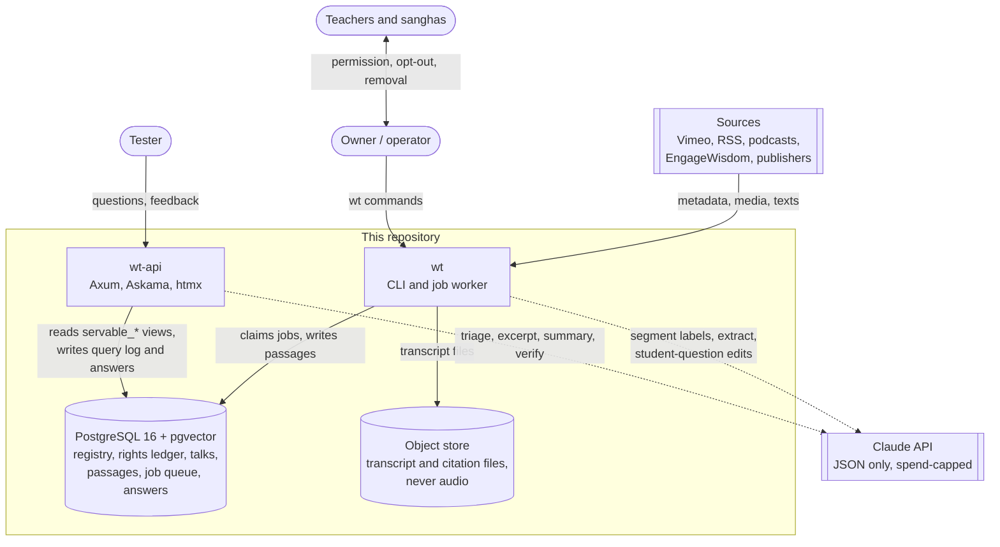
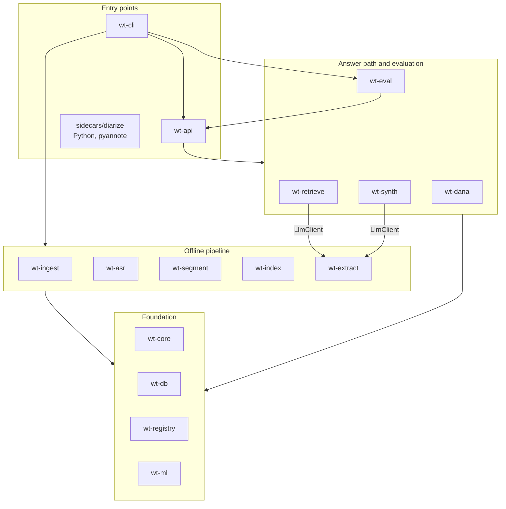
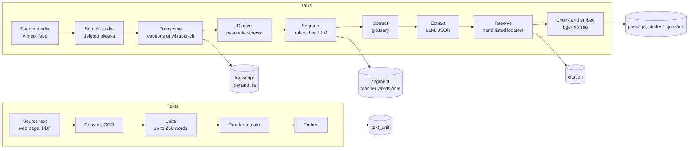
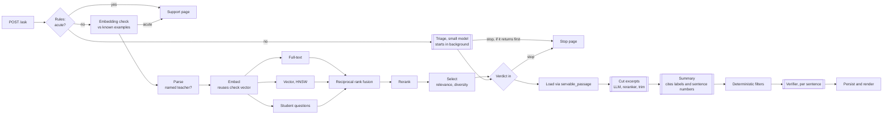
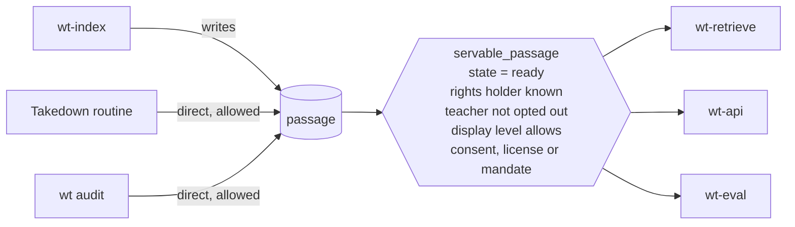
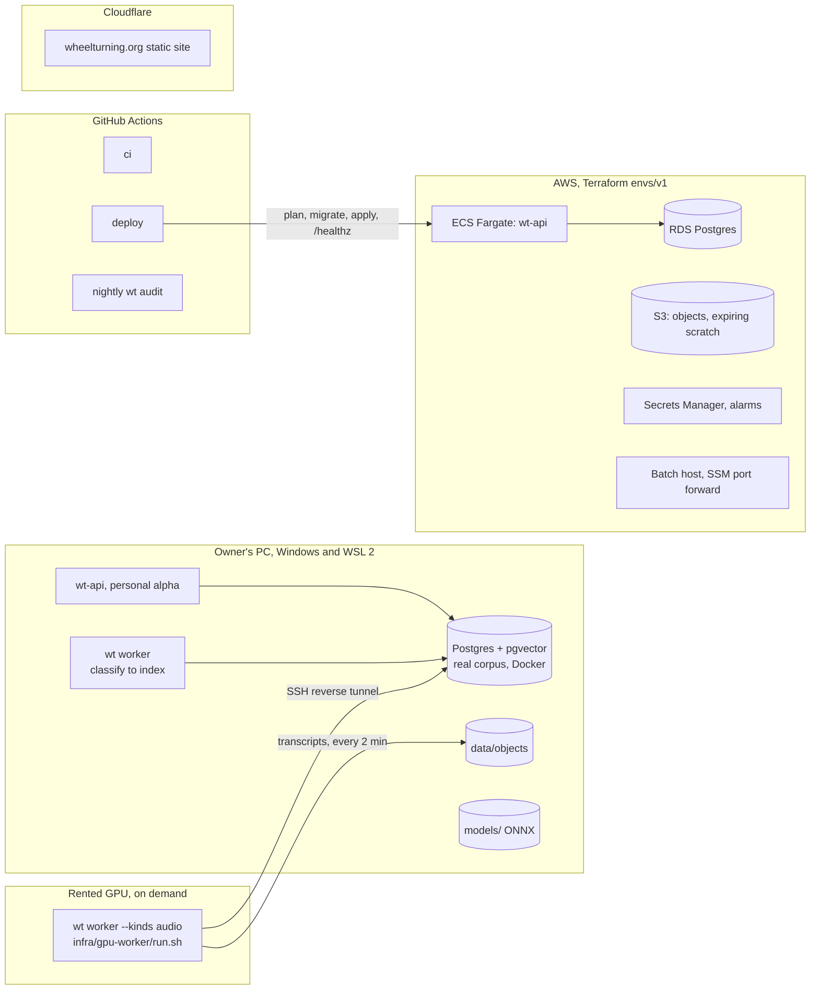

# Architecture

A guide for reviewers and newcomers: what the parts are, how a talk becomes servable passages, how a question is answered, and where the rules in `CLAUDE.md` are enforced. The specs in `docs/specs/` are binding; this page only maps them onto the code. Checked against `main` at 05d3c56 (October 13, 2026). Update it in the pull request that changes what it shows.

Two promises shape most of the design: nothing is served without a recorded rights basis (the teacher's consent, a verified license, or the owner's mandate for a teacher who has not opted out), and nothing shown as a quotation is written by a language model.

## System context

Two Rust processes share one Postgres database. `wt-api` serves testers. `wt` is the operator's command line and the job worker that turns recordings into indexed passages. The only outside services are the talk and text sources and the Claude API.

Teachers also reach the project through the `/rights` request form. The operator records each answer with `wt rights` and `wt teacher opt-out`, and the database decides what is servable. Audio is fetched into a scratch directory and deleted after each job, so it appears in no store.

## Crates

The workspace splits along one line: the offline pipeline that builds the index, and the online path that answers questions. Both sit on `wt-core` (types, the rights gate, configuration) and `wt-db` (repositories and the job queue). Queries are checked at compile time by sqlx; most live in `wt-db`, but search (`wt-retrieve`), the index writer (`wt-index`) and evaluation (`wt-eval`) run their own. External services sit behind traits so tests run against fakes.

Arrows mean "depends on". `wt-cli` links `wt-api`'s library so that `wt eval run` answers questions through the same function as the web route.

| Crate | Owns | Depends on |
|---|---|---|
| `wt-core` | Domain types and ids, the rights-gate typestate, configuration and `Secret`, the scratch directory, the list of stores takedown must empty | none |
| `wt-ml` | `Embedder` and `Reranker` traits; bge-m3 and bge-reranker-v2-m3 in int8 ONNX through `ort` | none |
| `wt-dana` | Split calculator for the giving panel | core |
| `wt-registry` | Teachers, aliases, sanghas, glossary matching | core, dana |
| `wt-db` | Pool, migration runner, repositories, job queue, takedown, audit | core, registry |
| `wt-asr` | `Transcriber` trait, caption parsers, the `whisper-cli` runner, alignment, ASR benchmark | core |
| `wt-segment` | `Diarizer` client, segmenter (rules first, a model labels only the windows the rules leave unclear), student-speech removal, student-question checks | core |
| `wt-extract` | `LlmClient` with spend cap and real-data switch; citation extraction and resolution | core, db, segment |
| `wt-index` | Chunker and index writer; writes `passage` and `student_question` | core |
| `wt-ingest` | Source adapters (Vimeo, RSS and podcasts, EngageWisdom), classification, the audio job, text import (crawl, PDF and OCR, proofreading) | asr, segment, extract, index, ml, core, db, registry |
| `wt-retrieve` | Query parsing, full-text, vector and question search, rank fusion, rerank, selection, sensitive-question triage | core, ml, extract |
| `wt-synth` | Summary generation, deterministic filters, verifier | core, extract |
| `wt-api` | Routes and pages, invite sessions, the ask path, live progress (SSE), rights and accessibility forms | core, dana, db, extract, ml, retrieve, synth |
| `wt-eval` | Question-set runs, ratings, claim audit, run comparison, scoring of sensitive-question routes | api, core, db, ml, retrieve |
| `wt-cli` | The `wt` binary: operator commands and the job worker | 12 workspace crates |

## Talk lifecycle

```mermaid
stateDiagram-v2
  direction LR
  [*] --> discovered
  discovered --> awaiting_consent: classify
  discovered --> needs_review: classify, unsure
  discovered --> excluded: classify, non-talk or duplicate
  discovered --> cleared: classify, basis already recorded
  needs_review --> awaiting_consent: person decides
  awaiting_consent --> cleared: rights gate
  cleared --> fetching: wt pipeline advance
  state "audio job" as audio {
    fetching --> transcribing
    transcribing --> diarizing
    diarizing --> segmenting
  }
  state "needs_review (pipeline hold)" as held
  fetching --> held: no media, several speakers
  held --> cleared: wt pipeline retry-held
  segmenting --> correcting: correct job
  correcting --> extracting: extract job
  extracting --> resolving: resolve job
  resolving --> indexing: index job
  indexing --> ready
  ready --> quarantined: held, nothing deleted
  quarantined --> ready
  ready --> withdrawn: takedown routine only
```

A talk is a row in `talk` with a `talk_state`. Nothing can fetch, transcribe or index a talk until it passes the rights gate, which is enforced twice: every pipeline function takes a `&Talk<Consented>` that only `Talk::authorize` produces (`wt-core/src/gate.rs`), and the `past_gate_requires_consent` check constraint refuses any state past the gate without a rights basis.

Each step is a row in `job`, claimed with `FOR UPDATE SKIP LOCKED`, finished inside the handler's transaction, retried with backoff and keyed by content hash, so a rerun on unchanged input does nothing (`wt-db/src/job.rs`). The four audio steps run as one `audio` job so audio never leaves the machine that fetched it. Every job authorizes the talk again before it runs, so a consent change stops the talk at the next job. A hold after the gate is also stored as `needs_review`, with a pipeline reason such as `no_media`; any of `cleared` and the four audio states can be held, not only `fetching`. `wt pipeline retry-held` releases only those reasons, so it never moves a talk across the gate. Talks whose only source is a published transcript skip fetching, transcription and diarization: the text becomes timed words and enters at segmentation. `withdrawn` is reachable from most states; only the takedown routine sets it.

## Transcript pipeline

The language model never writes transcript text. Segmentation labels windows by rule and asks the model only about the ones the rules leave unclear; student speech is dropped there. Extraction returns JSON hints, and resolution maps them only onto locators from a hand-made list. A student question that a teacher answers is lightly edited by the model, checked in code, shown with a "Student" label and an edit label, and written by the index step. Calls carrying real transcript text are refused unless `WT_LLM_REAL_DATA_OK` is set, and every call is logged in `llm_usage` against a monthly cap (`WT_LLM_MONTHLY_CAP_USD`, overridable with `wt llm cap set`). Texts are imported with `wt text import`, a dry run unless `--apply` is given; they are searched in their own section and never count as teachers.

## Question path

`wt_api::ask::answer_framed` answers every question, for `POST /ask` and for `wt eval run`, and times each stage.

Sensitivity is checked in three layers before anything is shown. Rules come first, and an acute match goes straight to the support page. Otherwise the route starts the model triage in the background and runs the embedding check; an acute result there cancels the triage. Retrieval then runs while the triage is still out. If the triage returns first with a stop, the function returns at once and the unfinished retrieval is cancelled; otherwise it waits for the verdict before loading passages. Retrieval is read-only and local, so running it alongside the triage removes the triage's round trip from most questions at no risk. The triage can only raise the level, never lower it.

Selection's input type has no field for sangha, profile, upload volume or donation link. Quotations are sliced by code from stored passages; the summary model returns excerpt labels and sentence numbers. A failed or slow model call drops the summary and nothing else. Named-teacher and sensitive questions skip the summary. Progress streams over server-sent events: reading, searching, weighing, choosing, writing.

## Serving boundary

Rights decisions live in the `servable_passage` view. Serving code never reads the `passage` table, so a revoked consent, an opt-out or a display-level change takes effect on the next query without touching the index.

Two mechanisms enforce the line. `wt-core/tests/repo_guards.rs` fails CI on direct SQL reads of `passage` or `student_question` outside the named modules. In the AWS database the web service logs in as `wt_web_login`, whose role is granted the `servable_*` views and not `passage` (migration 0008); a local database with one development login relies on the test alone. The same pattern covers `servable_text_unit`, `servable_student_question` and `servable_citation`. The view's security barrier is reset on purpose so vector search keeps using the HNSW index (migration 0012, reapplied in later redefinitions).

## Where it runs

As of October 13, 2026. See `docs/runbook.md` for procedures.

CI runs the five checks in `CLAUDE.md` plus cargo machete, Terraform validate and tflint, ruff, gitleaks, workflow lint, typos and the accessibility suite. The nightly audit runs against the database in the `WT_AUDIT_DATABASE_URL` secret, or a freshly migrated one when that secret is unset. Deploy applies Terraform in two plans around a migration step that runs as `wt_owner`, then checks `/healthz` over HTTPS. The GPU script stops its workers after a set number of hours.

## Invariants and where they are enforced

| Rule | Mechanism | Look at |
|---|---|---|
| No work on a talk without a rights basis | `Talk<Consented>` typestate on every pipeline function; `past_gate_requires_consent` constraint | `wt-core/src/gate.rs`, migrations 0011, 0017 |
| Serve only what is servable | `servable_*` views; repository guard test; web role has no grant on `passage` in AWS | migrations 0008, 0038; `wt-core/tests/repo_guards.rs` |
| Ranking is blind to sangha, profile, volume and donations | The selection input type has no such fields | `wt-retrieve/src/select.rs` |
| No model-written quotations | Models return ids, labels and sentence numbers; code slices quotes; a verifier checks each summary sentence; edited student questions are labeled | `wt-synth/src/lib.rs`, `wt-synth/prompts/` |
| Audio is transient | Scratch directory deleted on success and failure; no audio column or bucket; audio files banned from the repository | `wt-core/src/scratch.rs`, `wt-ingest/src/audio.rs` |
| Real text reaches a model only by the owner's choice | `DataClass::Real` calls refused unless `WT_LLM_REAL_DATA_OK`; monthly cap with an 80 percent alert | `wt-extract/src/llm.rs`, migration 0018 |
| Takedown leaves nothing behind | One routine deletes from every store `wt-core` lists; `wt audit` runs nightly | `wt-core/src/stores.rs`, `wt-db/src/takedown.rs` |
| Stages are idempotent | Jobs keyed by content hash; leases checked on every write; stale locks reaped | `wt-db/src/job.rs` |
| No payment code | `cargo deny` bans payment crates; CI proves the ban with a fixture crate | `deny.toml`, `tests/deny-fixture` |
| Tests make no network calls | External services behind traits with fakes; Postgres tests start their own container | trait definitions in each crate |

## Where to start reading

- **Rights and consent:** Specs 03 and 08; `crates/wt-core/src/gate.rs`, `crates/wt-db/src/rights.rs`, `crates/wt-db/src/takedown.rs`
- **Answering a question:** Spec 05; `crates/wt-api/src/ask.rs`, `crates/wt-retrieve/src/lib.rs`, `crates/wt-retrieve/src/sensitive/triage.rs`, `crates/wt-synth/src/lib.rs`
- **The pipeline:** Spec 04; `crates/wt-db/src/job.rs`, `crates/wt-ingest/src/pipeline.rs`, `crates/wt-ingest/src/audio.rs`, `crates/wt-index/src/`
- **Schema:** Spec 02; migrations 0002 to 0006 for the core tables and views, 0015 for the rights ledger, and `docs/migrations.md`
- **Web and access:** Spec 06; `crates/wt-api/src/lib.rs` (routes), `crates/wt-api/src/session.rs`
- **Operations:** Spec 07; `docs/runbook.md`, `infra/terraform/envs/v1/`, `.github/workflows/`
